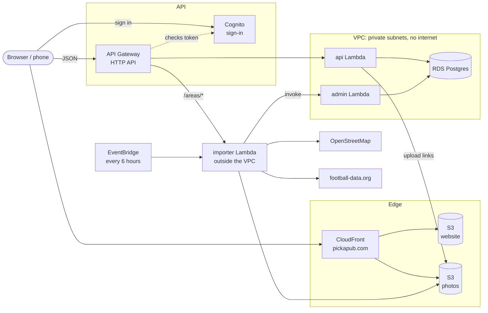
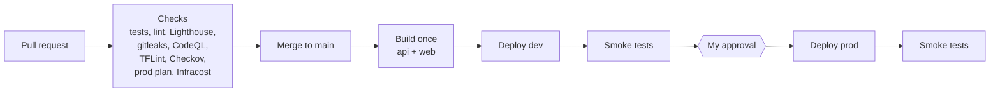

# How Pick-a-Pub works

Pick-a-Pub rates UK pubs for watching football. Fans score the view of the
screen, the sound, the crowd and so on, and the site ranks nearby pubs by those
scores. It also answers "where's this match showing?" for upcoming games.

It runs on AWS, serverless apart from a small Postgres database, built with
Terraform and deployed by GitHub Actions. This page is the one-page tour; the
[README](README.md) has the detail.

## In one minute

- **Website:** a static Next.js site in S3, served by CloudFront on
  `pickapub.com`. No servers.
- **API:** API Gateway in front of Lambda (Node 22, TypeScript). API Gateway
  checks the Cognito sign-in token before any code runs.
- **Data:** RDS Postgres in private subnets. The Lambdas log in with short-lived
  IAM tokens, not a password.
- **Pubs** come from OpenStreetMap, imported on demand the first time someone
  searches a new area. **Matches** come from football-data.org every 6 hours.
- **Two environments** (dev and prod) from the same Terraform, in one AWS
  account. Every merge deploys to dev, runs smoke tests, then waits for my
  approval before prod.

## The picture

## A request, step by step

Someone opens the Balham list:

1. CloudFront serves the static page from S3. A small CloudFront Function maps
   `/pub/` to `/pub/index.html`, and `/config.js` tells the page which API to use.
2. The page calls `GET /pubs?lat=..&lng=..` (`web/lib/api.ts`).
3. API Gateway sends it to the api Lambda. For signed-in routes it first checks
   the Cognito token and rejects bad ones itself.
4. `api/src/handlers/api.ts` turns the event into a plain request;
   `api/src/routes/index.ts` looks up the handler in the route table.
5. The handler (`routes/pubs.ts`) checks the input, then runs one SQL query:
   pubs within the radius (Postgres `earthdistance`), joined to the
   `pub_scores` view that turns reviews into stars.
6. JSON goes back. A thrown `HttpError` becomes a 4xx; anything else is logged
   and becomes a 500, which sets off an alarm.

Searching somewhere new adds a step: the page calls `POST /areas/import`, the
importer claims that area's "tile" (so two people searching at once don't import
twice), fetches pubs from OpenStreetMap in the background, and hands them to the
admin Lambda to save. The page checks `/areas/status` until it's ready.

## The pieces

| Piece | Code | Why this way |
| --- | --- | --- |
| Website | `web/` (Next.js static export) | No servers to run or patch; CloudFront caches it worldwide |
| API | `api/src/routes/` | One small Lambda; pay per request, scales to zero |
| Admin jobs | `api/src/admin/` | A separate Lambda with no public route: only AWS credentials can call it |
| Area importer | `api/src/handlers/importer.ts` | Outside the VPC so it can reach the internet without a NAT gateway (about £30 a month saved) |
| Database | `db/schema.sql`, `infra/database.tf` | Ratings are relational (pubs, reviews, users) and need distance queries |
| Sign-in | `infra/auth.tf`, `web/lib/auth.tsx` | Cognito hosted login; no passwords in our code |
| Photos | `api/src/services/photos.ts`, `infra/photos.tf` | Uploads go straight from the browser to S3 with a one-off link; hidden until approved |
| Infrastructure | `infra/` | Terraform, same code for dev and prod (`infra/envs/*.tfvars`) |
| Pipeline | `.github/workflows/` | Checks on every PR, build once, deploy dev, approve prod |

## The data

The main tables in `db/schema.sql`:

- `pubs`: from OpenStreetMap (name, address, location, opening hours and so on).
- `users` and `reviews`: one review per user per pub, scores 1 to 5 plus yes/no facts.
- `pub_scores` (a view): turns reviews into star ratings, weighted by `rating_weights`.
- `pub_editorial`: our own verdicts, loaded from `content/pubs.yaml`.
- `pub_photos`, `review_reports`: uploads and moderation.
- `fixtures`: upcoming matches. `import_tiles`: which areas have been imported.
- `page_views`: cookie-free page counts (IP addresses are hashed with a daily salt).

The schema is applied on every deploy (`migrate`), so it is written to be safe to
run again (`create table if not exists` and so on).

## Security

- **Network:** Lambdas and RDS sit in private subnets with no route to the
  internet. The only way out is a free S3 gateway endpoint for photos. The
  database security group only accepts the Lambda security group.
- **Database login:** IAM authentication. The Lambdas sign a 15-minute token for
  a limited app user (`api/src/lib/db.ts`). The master password is used once per
  deploy to set that user up.
- **Least privilege:** each Lambda role allows only what it uses (for example,
  the importer can invoke the admin Lambda and write to one S3 prefix).
- **At rest:** RDS storage and S3 buckets are encrypted; buckets block public
  access and are read only through CloudFront (origin access control).
- **In the browser:** security headers from CloudFront (CSP, HSTS and so on),
  and the sign-in token is checked by API Gateway, not our code.
- **Abuse:** API Gateway rate limits per route (slower for imports and page
  counts). Three reports hide a review until it's checked.
- **Pipeline:** GitHub Actions uses OIDC to assume an AWS role, so there are no
  stored AWS keys. Secrets scanning (gitleaks), CodeQL, Checkov and TFLint run
  on every PR.

## Delivery

- `main` is protected: changes only arrive through a pull request with all
  checks passing.
- The same build goes to dev and prod. Only `config.js` differs, so what was
  tested on dev is exactly what goes live.
- Each PR gets a comment with the prod Terraform plan and the cost change.
- Dependabot keeps packages up to date; minor and patch updates merge
  themselves once the checks pass.

## Monitoring

CloudWatch alarms email me (SNS) for: API errors, throttling, 5xx and slow
responses; importer jobs that fail all 3 tries, or 5+ errors in 15 minutes;
database CPU, storage, memory, swap and connections. There is one CloudWatch
dashboard per environment.

## Decisions and trade-offs

These are the choices worth talking through:

- **No NAT gateway.** The internet-facing importer lives outside the VPC and
  hands data to the admin Lambda inside it. That saves about £30 a month per
  environment, at the cost of one extra hop.
- **Serverless plus one database.** Lambda and API Gateway cost nothing when
  idle. RDS (`db.t4g.micro`, single AZ) is the only always-on cost, about £12 a
  month. Multi-AZ would double that for availability this site doesn't need yet.
- **Import on demand, not all of the UK up front.** It keeps the database small,
  and the tile claim stops duplicate imports. The trade-off is a wait of up to a
  minute the first time an area is searched.
- **Build once, promote.** One artifact, runtime config per environment. No
  "works on dev, different on prod" builds.
- **Same Terraform for both environments.** Differences live in `tfvars`
  (instance size, deletion protection, domain), never in copied code.

## Where to change things

| I want to... | Look in |
| --- | --- |
| Add an API endpoint | `api/src/routes/` + `infra/api_gateway.tf` (README: "To add an endpoint") |
| Change how stars are worked out | `db/schema.sql` (`pub_scores`, `rating_weights`) |
| Change what a page shows | `web/app/` and `web/components/` |
| Change page behaviour (loading, filters) | `web/hooks/` |
| Add a label or filter | `web/lib/ratings.ts` and `api/src/lib/ratings.ts` |
| Add an alarm | `infra/monitoring.tf` |
| Change prod vs dev settings | `infra/envs/prod.tfvars`, `infra/envs/dev.tfvars` |

## What I'd do next

- Scope the GitHub deploy roles down from AdministratorAccess.
- End-to-end browser tests in the pipeline (Playwright), and a nightly
  Terraform drift check.
- Block sign-ups from disposable email domains and clear out unconfirmed accounts.
